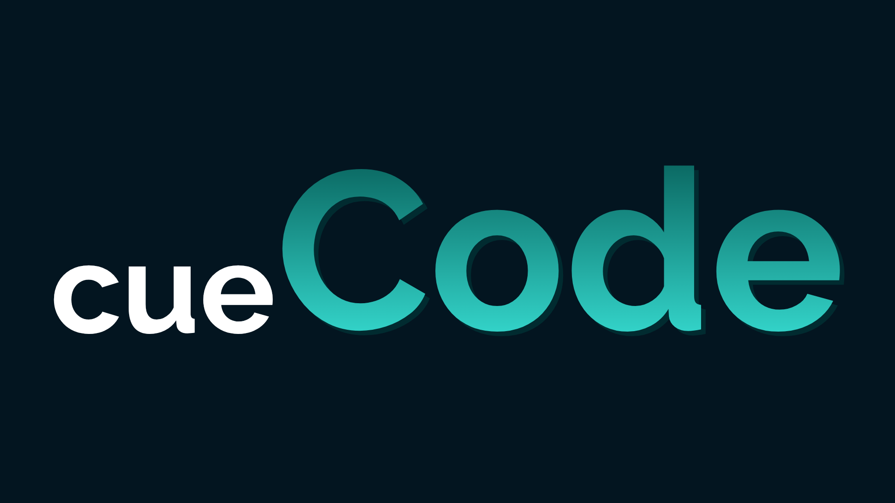

# Hola, soy Agustín 👋

**Desarrollador web junior y estudiante de la Licenciatura en Sistemas** en la [Universidad Nacional de Lanús](https://www.unla.edu.ar/) · Buenos Aires, Argentina 🇦🇷

Construyo **interfaces web** con HTML, SCSS, JavaScript y React, **APIs backend** con Node.js, Express y MongoDB, y hago **análisis de datos** con SQL Server y Power BI. Me gusta documentar bien lo que hago: cada proyecto tiene un README que explica qué es, cómo funciona y cómo correrlo.

- Actualmente: reescribiendo mi e-commerce **EKOS** en React y avanzando en **Data Science**.
- Aprendiendo: Python, Pandas y Machine Learning
- Contacto: **agustin.cuenca.ct@gmail.com**
- CV: 

---

## Proyectos destacados

### 🔐 [Backend — Autenticación híbrida con Node.js](https://github.com/aguscuuuu/backend)
API REST con **Express 5 + MongoDB** que combina login local (bcrypt), **GitHub OAuth**, **JWT** y sesiones persistidas en Mongo, con rutas protegidas por token y por rol. Arquitectura en capas, logging con Winston, **tests funcionales** (Mocha, Chai, Supertest, Sinon) e imagen **Docker** publicada en DockerHub.

`Node.js` `Express` `MongoDB` `Passport` `JWT` `Socket.IO` `Docker`

<!-- poner imagen  -->

### 📊 [Nike Sales Analytics — SQL Server + Power BI](https://github.com/aguscuuuu/data-analytics-nike)
Proyecto integrador del curso de **Data Analytics de Coderhouse**: 229.471 ventas modeladas en un **esquema estrella** en SQL Server, carga y limpieza desde JSON con T-SQL, y un **informe de ventas en Power BI** pensado con storytelling para un equipo de marketing.

`SQL Server` `T-SQL` `Power BI` `DAX` `Excel`

<!-- poner imagen  -->

### 💍 [EKOS Accesorios — E-commerce](https://github.com/aguscuuuu/coder-ekos) · [**Ver sitio**](https://aguscuuuu.github.io/coder-ekos/)
Mi primer frontend: tienda online de joyería y accesorios, responsive, con catálogo, medios de pago, envíos y contacto. La estoy reescribiendo con React en [coder-ekos-react](https://github.com/aguscuuuu/coder-ekos-react).

`HTML` `SCSS` `JavaScript` `Bootstrap` `React`

<!-- poner imagen  -->

### 🧠 [Programación en C — UNLa](https://github.com/aguscuuuu/unla-c)
Ejercicios de la materia de Programación de la UNLa: estructuras, punteros, memoria dinámica, listas, pilas, colas, árboles y archivos, más modelos de parciales y finales (2019–2023) con pruebas de escritorio.

`C` `Algoritmos` `Estructuras de datos`

---

## Otros proyectos

| Proyecto | Descripción | Stack |
| --- | --- | --- |
| [Pomodoro Timer · demo](https://github.com/aguscuuuu/pomodoro) | Reloj Pomodoro minimalista y responsive para mejorar la productividad | HTML · CSS · JS |
| [Cards Total · demo](https://github.com/aguscuuuu/cards-total) | Juego para practicar cálculo mental sumando cartas (mazo español o de póker) | HTML · CSS · JS |
| [cueCode · demo](https://github.com/aguscuuuu/personal-site) | Mi sitio personal / portfolio | HTML · SCSS · JS |
| [Ejercicios de JavaScript · demo](https://github.com/aguscuuuu/coder-js) | Algoritmos y manipulación del DOM del curso de JavaScript de Coderhouse | HTML · JS |

---

## Mi sitio personal

<!-- imagen -->

---

## Tecnologías

**Frontend**

**Backend**

**Datos y lenguajes**

 <!-- agregar power bi y sql server -->

**Herramientas**

---

## Formación

- **Licenciatura en Sistemas** — Universidad Nacional de Lanús *(en curso)*
- **Coderhouse** — [Desarrollo Web](https://www.linkedin.com/in/agustin-ezequiel-cuenca/details/certifications/) · [JavaScript](https://www.linkedin.com/in/agustin-ezequiel-cuenca/details/certifications/) · [React](https://www.linkedin.com/in/agustin-ezequiel-cuenca/details/certifications/) · [Backend](https://www.linkedin.com/in/agustin-ezequiel-cuenca/details/certifications/) · [Data Analytics](https://www.linkedin.com/in/agustin-ezequiel-cuenca/details/certifications/) 

---

## aContactame

  
  
  

